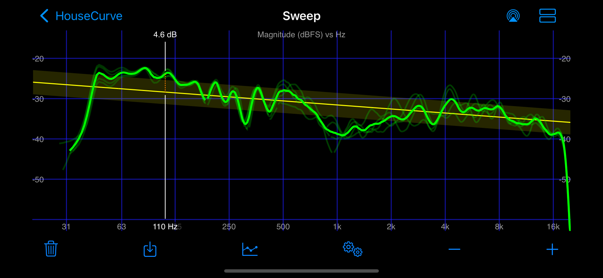
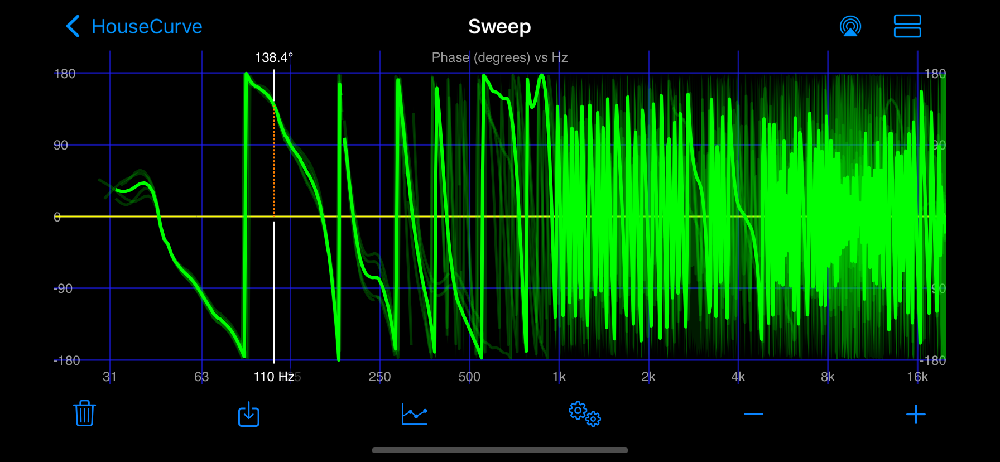
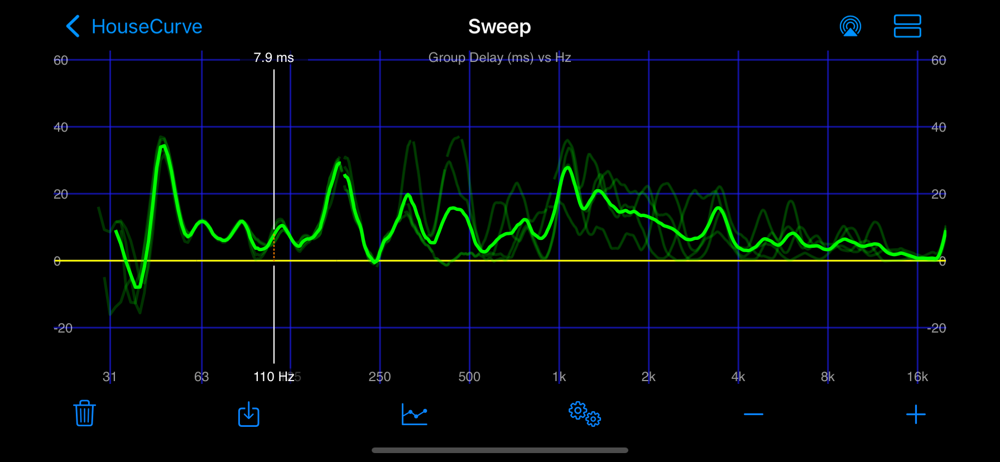
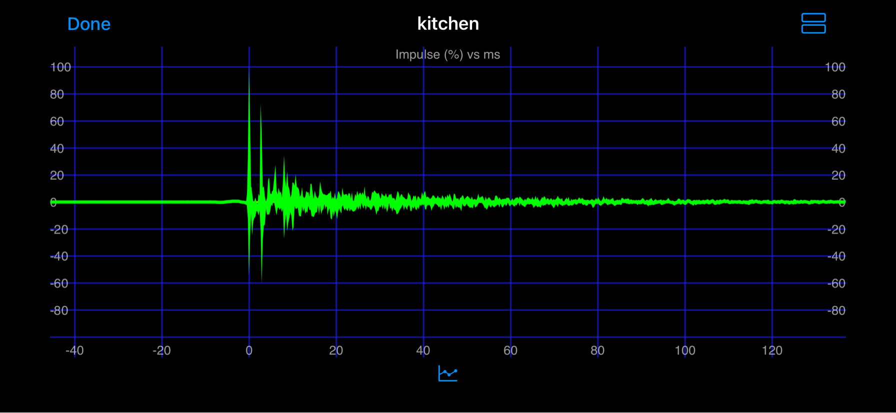
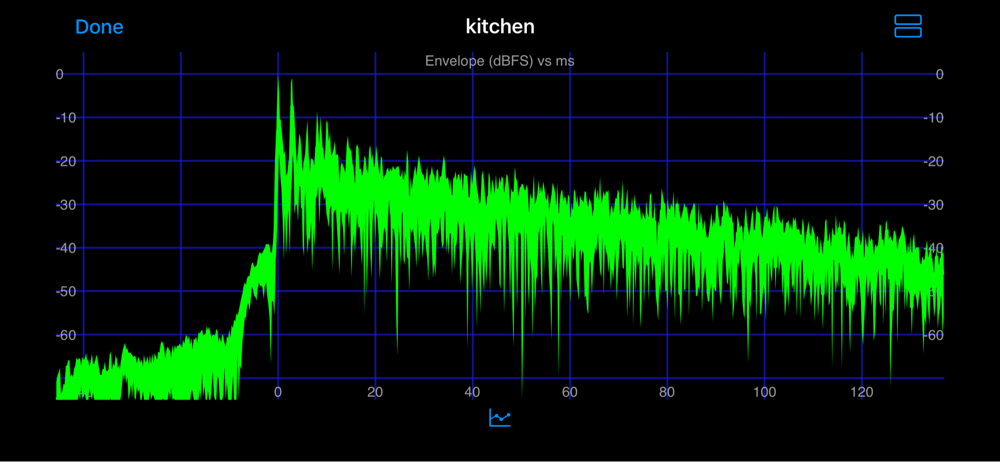
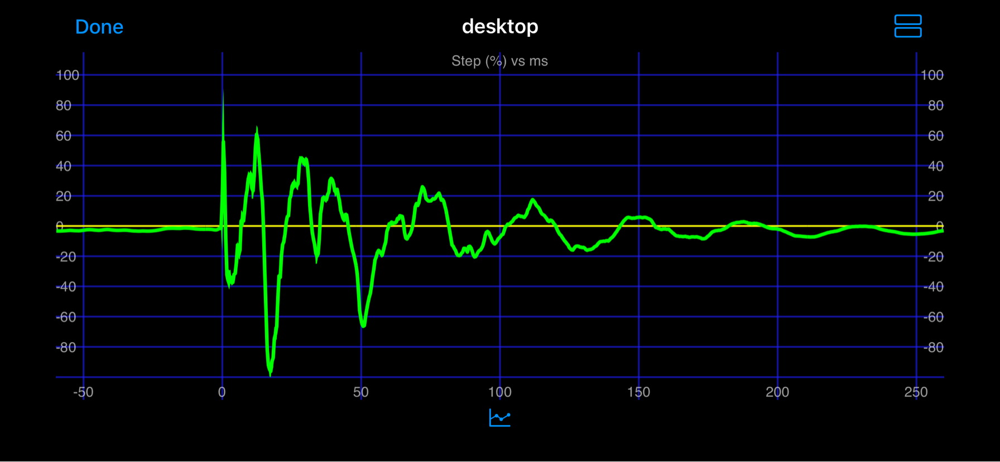

# Plot Types
HouseCurve displays successful measurements using magnitude, phase and group delay plots.  Switch between plot types by tapping 

## Magnitude Plot
The magnitude plot is the most important plot for tuning.  The overall level of the magnitude measurement is the “volume” or output power of the audio system.  The level differences between frequencies are what we want to change when [applying equalization](../tuning/equalization.md).

The magnitude plot is commonly referred to as the “frequency response” of the audio system.  Since the magnitude plot is displayed in decibels, it is also correct to refer to it as the "power" plot.

## Phase plot
The phase plot shows the phase of the measurement versus frequency.  Phase plots can be used for [time aligning speakers](../tuning/time_align.md#time-align-using-phase).

This style of phase plot is traditionally referred to as a “wrapped phase” plot.  The vertical green lines on the plot are referred to as “wraps”.  A wrap is a frequency where the phase exceeds the range of the plot and “wraps” around to the other vertical extreme of the plot.  A wrap is an artifact of the plot and not and indication that the phase is suddenly changing by 360 degrees.

## Group Delay Plot
The group delay plot shows “when” the sound at a given frequency arrives at the microphone.  The group delay plot can be used to double check [speaker time alignment](../tuning/time_align.md).  Extreme peaks in the group delay may indicate regions that can’t be fixed by equalization, such as poor time alignment or problematic room interactions.

## Impulse Plot
The impulse plot shows how an audio system and room respond to an impulse of energy over time.  This is the equivalent of firing a gun or popping a balloon in the room.  These plots are useful for time alignment and planning out room treatments.

The initial spike on the left of the plot represents sound that travelled directly from speaker to microphone (aka "the direct sound").  Moving towards the right, smaller spikes represent sound that first bounced off surfaces of your room before reaching the microphone (aka "early reflections").  The long tail represents the reverberant response of the room.

## Envelope Plot
The envelope plot (aka "envelope time curve" or ETC) is very similar to the impulse plot.  It shows how sound energy decays over time in decibels.  The envelope plot can be used to make decisions about room treatements, ex: identifying early reflections worth treating.

## Step Plot
The step plot is the integral of the impulse plot (running sum).  It shows how the audio system would resond to a sudden change in input, aka a "step".  The step plot can be used to evaluate time alignment, speaker driver handoffs and transient behavior.

